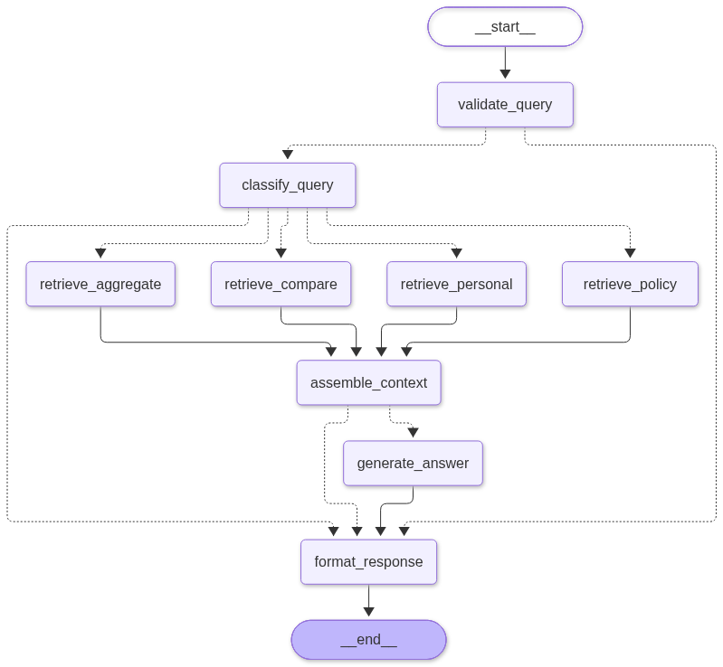

# AI-Powered Payroll Query and Management System

Employees and HR ask payroll questions in natural language ("What was my net
salary in March?", "Why was my salary different last month?", "What is our
overtime policy?"). The backend retrieves the relevant payslip or policy data
using RAG (Retrieval-Augmented Generation) and answers in plain English, with
JWT authentication, role-based access control, audit logging, and caching.

## Tech Stack

| Layer | Technology |
|---|---|
| API | FastAPI |
| Database | PostgreSQL (SQLAlchemy ORM) |
| Auth | JWT (PyJWT), bcrypt, role-based access (employee / hr) |
| Vector DB | ChromaDB (persisted locally) |
| Embeddings | HuggingFace `all-MiniLM-L6-v2` (local, free) |
| AI orchestration | LangChain + LangGraph |
| LLM | Groq (Llama 3.3 70B) |
| Cache | Redis (Memurai on Windows), with in-memory fallback |
| Encryption | Fernet (`cryptography`) for salary fields |
| Validation | Pydantic |

## Architecture


```
Client (Swagger / frontend)
   |
   v
FastAPI
   |-- Logging middleware (user, endpoint, latency, AI response -> logs table)
   |-- JWT authentication + role check (employee / hr)
   |
   |-- Auth routes      /auth/*, /user/me
   |-- Payroll routes   /payslip/*, /policy/*   -> PostgreSQL
   |                                            -> Chroma (re-embed)
   |                                            -> Cache (invalidate)
   |-- Chat route       /chat/query -> Cache -> LangGraph RAG pipeline
   |                                              |-> Chroma (filtered retrieval)
   |                                              |-> Groq LLM
   |-- Logs route       /logs (HR only)
```

**Two stores, one source of truth.** PostgreSQL holds the authoritative data.
Chroma is a searchable copy that is updated on every payslip or policy change
and can be rebuilt at any time with `python reindex.py`.

## Project Structure

```
payroll-ai/
├── app/
│   ├── main.py              App creation, middleware, routers
│   ├── config.py            Settings loaded from .env
│   ├── database.py          Engine, session, get_db dependency
│   ├── models.py            users, payslips, policies, logs tables
│   ├── schemas.py           Pydantic request/response models
│   ├── security.py          bcrypt hashing, JWT creation/verification
│   ├── crypto.py            Encrypted column type for salary fields
│   ├── deps.py              get_current_user, require_hr
│   ├── routers/             auth, users, payslip, policy, chat, logs
│   ├── services/            vector_store.py, cache.py
│   ├── ai/graph.py          LangGraph RAG workflow
│   └── middleware/          request_logger.py
├── tests/                   pytest access-control tests
├── create_admin.py          Creates the first HR user
├── reindex.py               Rebuilds the vector index from PostgreSQL
├── draw_graph.py            Generates workflow.png
├── test_rag.py, test_search.py
└── README.md, VECTORDB.md, RAG.md, SAMPLE_QUERIES.md
```

## Database Schema


| Table | Columns |
|---|---|
| users | id, name, email (unique), password_hash, role |
| payslips | id, user_id (FK), month, year, gross_salary, deductions, net_salary, bonuses, pdf_url. Unique on (user_id, month, year) |
| policies | id, title, content, updated_at |
| logs | id, timestamp, user_id, method, endpoint, status_code, response_time_ms, question, ai_response |

`net_salary` is calculated by the server (gross + bonuses - deductions), never
trusted from input. Month and year stay in plain text so payslips can be looked
up. Salary amounts are encrypted (see Security).

## Flow

### 1. Authentication flow
1. `POST /auth/register` creates an employee. The password is hashed with bcrypt.
   Register can never create an HR user; HR accounts come from `create_admin.py`.
2. `POST /auth/login` verifies the password and returns a signed JWT (user id,
   role, expiry).
3. Every protected request sends `Authorization: Bearer <token>`. The
   `get_current_user` dependency verifies it (401 on failure) and `require_hr`
   rejects non-HR users (403).

### 2. Payslip / policy upload flow (HR)
1. HR calls `POST /payslip/upload` (or `POST /policy`). Pydantic validates the input.
2. The server calculates `net_salary` and saves the row to PostgreSQL
   (salary fields encrypted).
3. The record is converted to a text summary, embedded, and stored in Chroma with
   metadata (`type`, `user_id`, `month`, `year`). Long policies are split into
   overlapping chunks.
4. The affected cache entries are invalidated (the user's entries for a payslip,
   all entries for a policy).

### 3. Chat (RAG) flow
1. The user calls `POST /chat/query`. The `user_id` is taken from the JWT.
2. The cache is checked first. A hit returns immediately with `cached: true`.
3. On a miss the LangGraph workflow runs (below), the answer is cached, and the
   question and answer are saved to the `logs` table by the middleware.

## RAG Workflow (LangGraph)



| Node | Purpose |
|---|---|
| validate_query | Rejects empty or too-short questions |
| classify_query | The LLM returns structured JSON: query type (personal, policy, both, compare, off_topic) plus month and year if mentioned |
| retrieve_personal | Vector search filtered by `user_id` (from the JWT) and type, plus month/year if given |
| retrieve_policy | Vector search over global policy documents |
| retrieve_compare | Exact lookup of the requested month and the previous month (or the two latest payslips), filtered by `user_id` |
| assemble_context | Joins the retrieved text and builds the sources list |
| generate_answer | The Groq LLM answers using only the context |
| format_response | Cleans and returns the final answer |

Conditional routing:
- **Personal** question: filter by `user_id`.
- **Policy** question: fetch global documents.
- **Both**: both retrievers run in parallel and their results are merged.
- **Compare** ("Why was my salary different last month?"): fetches two periods and
  the LLM states the exact differences without inventing reasons.
- **Off-topic**: returns a polite refusal without retrieval or an LLM answer.
- **Nothing retrieved**: returns `No record found for the given period.` and skips
  the LLM entirely.

Guardrails: the prompt forbids guessing numbers, treats retrieved text as data
(not instructions), and requires the model to say so when information is missing.

## Security

- **Passwords** are hashed with bcrypt (one-way, salted).
- **Salary fields** (gross, deductions, net, bonuses) are encrypted at rest in
  PostgreSQL with Fernet (AES-based) through a custom SQLAlchemy column type.
  They are decrypted only inside the application for authorised requests. Financial
  data is encrypted rather than hashed because the API must return the real values.
- **JWT** is required on all protected routes. Role is checked on every HR route.
- **Access control:** employees can read only their own payslips (403 otherwise);
  HR can read and manage any employee's data.
- **RAG isolation:** retrieval is always filtered by the `user_id` from the verified
  token, never from the question text, so an employee cannot retrieve another
  employee's data through the chatbot.
- **Input validation** with Pydantic on every endpoint (types, ranges, lengths).
- **Logs** never store passwords, tokens, or request bodies. Only the chat question
  and AI response are recorded, and the logs endpoint is HR-only.
- **Known limitation:** payslip summaries in the vector DB, cached answers in Redis,
  and AI responses in the audit log still contain salary text, because they must
  remain searchable or readable. A production deployment would add disk-level
  encryption and field-level redaction.

## Setup

1. Install Python 3.11+ and PostgreSQL. Create the database:
   `CREATE DATABASE payroll_db;`
2. Create and activate a virtual environment:
   `python -m venv venv` then `venv\Scripts\activate` (Windows) or
   `source venv/bin/activate` (Mac/Linux)
3. `pip install -r requirements.txt`
4. Copy `.env.example` to `.env` and fill in the values:
   - `DATABASE_URL`: your PostgreSQL connection string
   - `SECRET_KEY`: `python -c "import secrets; print(secrets.token_hex(32))"`
   - `ENCRYPTION_KEY`: `python -c "from cryptography.fernet import Fernet; print(Fernet.generate_key().decode())"`
     (back this up; losing it makes encrypted salaries unrecoverable)
   - `GROQ_API_KEY`: free key from console.groq.com
   - `REDIS_URL`: optional, e.g. `redis://localhost:6379/0`
5. `python create_admin.py` creates the HR user (`hr@company.com` / `hr12345678`)
6. `uvicorn app.main:app --reload` (tables are created on startup)
7. Open http://127.0.0.1:8000/docs
8. After uploading payslips or policies, or if the vector index is ever lost,
   run `python reindex.py` to rebuild it from PostgreSQL.

The first start downloads the embedding model (~90 MB). Redis is optional: if
`REDIS_URL` is empty or Redis is unreachable, the app uses an in-memory cache.

## Main Endpoints

| Method | Path | Access |
|---|---|---|
| POST | /auth/register, /auth/login | Public |
| GET | /user/me | Logged in |
| POST | /payslip/upload | HR |
| GET | /payslip/{month}/{year} | Own payslip (HR: any via `?user_id=`) |
| PUT / DELETE | /payslip/{month}/{year}?user_id= | HR |
| POST | /policy | HR |
| GET | /policy, /policy/{id} | Logged in |
| PUT / DELETE | /policy/{id} | HR |
| POST | /chat/query | Logged in |
| GET | /logs | HR |

Full interactive documentation: `/docs` (Swagger). Exported spec: `openapi.json`.

## Caching

Key format: `chat:{user_id}:{hash(question + date)}`, 1 hour TTL. The user id is in
the key, so one user's cached answer is never served to another. Entries are
cleared per user when that user's payslip is uploaded, updated, or deleted, and
fully cleared when a policy changes.

## Logging and Observability

Middleware records each request (user id, method, endpoint, status code, latency)
in the `logs` table. Chat requests also store the question and the AI response, so
every AI answer can be traced. HR can query them via `GET /logs?ai_only=true`.

## Testing

- `pytest -v` runs automated access-control tests (401, 403, 404 cases).
- `python test_rag.py` runs sample RAG queries. Results are in `SAMPLE_QUERIES.md`.
- `python test_search.py` verifies vector search and user isolation.

## Related Documents

- `VECTORDB.md`: vector database setup
- `RAG.md`: RAG implementation details
- `SAMPLE_QUERIES.md`: sample queries and responses

## Limitations and Future Work

- Alembic migrations instead of `create_all`
- Background queue for embedding and indexing
- Encrypt payslip text in the vector DB and redact amounts in logs
- Parse uploaded PDF payslips (currently structured data is summarised manually)
- Refresh tokens and rate limiting on login